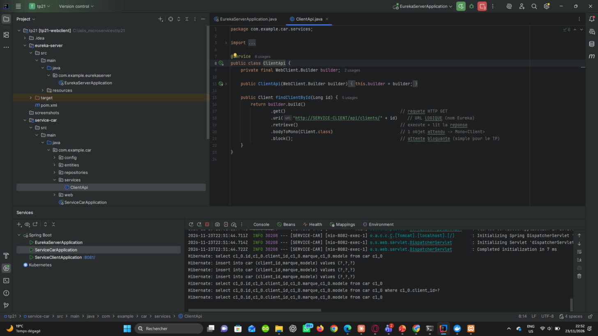
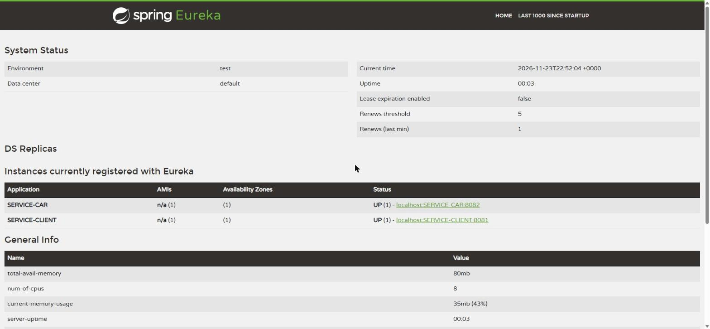
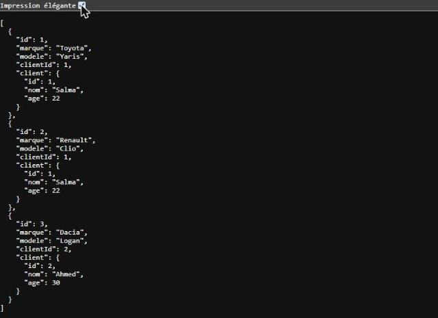
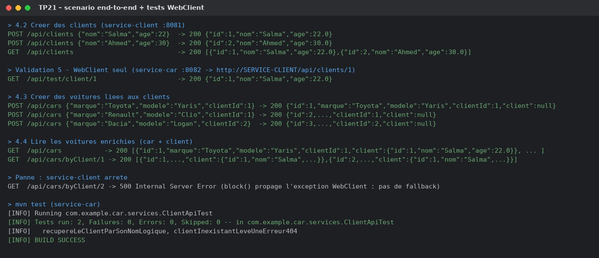

# TP 21 : Architecture microservices avec WebClient

Module **Architecture Microservices : conception, déploiement et orchestration**. Lab « TP 21 : Architecture Micro-services avec WebClient ».

Le TP reprend l'architecture du TP20 (Eureka, Client, Voiture), mais l'appel entre microservices utilise maintenant **WebClient**, le client HTTP réactif de Spring WebFlux. Il appelle directement le **nom logique Eureka** (`http://SERVICE-CLIENT/...`) grâce à `@LoadBalanced`, sans passer par une Gateway.

| Module | Port | Rôle | Dépendances |
|---|---|---|---|
| `eureka-server` | 8761 | Registre de services + tableau de bord | Eureka Server |
| `service-client` | 8081 | CRUD clients (`/api/clients`), MySQL `clientservicedb_wc` | Web, Data JPA, MySQL, Eureka Client |
| `service-car` | 8082 | Voitures (`/api/cars`) + appel de `service-client` via **WebClient**, MySQL `carservicedb_wc` | Web, Data JPA, MySQL, Eureka Client, **WebFlux**, **LoadBalancer** |

Versions : Java 17, Spring Boot 3.3.5, Spring Cloud 2023.0.6, MySQL 8 (XAMPP).

---

## 1. Ce qui change par rapport au TP20

| | TP20 (RestTemplate) | TP21 (WebClient) |
|---|---|---|
| Client HTTP | `RestTemplate` (synchrone, bloquant) | `WebClient` (réactif, non bloquant, ici utilisé avec `block()`) |
| Adresse appelée | `http://localhost:8888/SERVICE-CLIENT/...` (via la Gateway) | `http://SERVICE-CLIENT/...` (nom Eureka résolu côté client) |
| Qui choisit l'instance ? | La Gateway | **Spring Cloud LoadBalancer**, dans service-car (`@LoadBalanced`) |
| Modèle de réponse | DTO `CarResponse` construit avec `@Builder` | Entité `Car` avec un champ `@Transient Client client` |
| Dépendances en plus | – | `spring-boot-starter-webflux` et `spring-cloud-starter-loadbalancer` |

## 2. Architecture et trajet d'une requête

```
 GET /api/cars  ──▶ service-car :8082
                      1. repo.findAll()                        (MySQL carservicedb_wc)
                      2. pour chaque voiture :
                         WebClient GET http://SERVICE-CLIENT/api/clients/{clientId}
                               │  @LoadBalanced : "SERVICE-CLIENT" ─▶ Eureka ─▶ 192.168.x.x:8081
                               ▼
                         service-client :8081 ─▶ MySQL clientservicedb_wc
                      3. car.setClient(client)   (@Transient : non persisté)
                 ◀── JSON agrégé [{ "id":1, "marque":"Toyota", ..., "client":{...} }]
```

## 3. Le code clé

### `WebClientConfig` : le Builder « load-balancé »
```java
@Bean
@LoadBalanced                    // sans elle : UnknownHostException SERVICE-CLIENT
public WebClient.Builder webClientBuilder() {
    return WebClient.builder();
}
```
`@LoadBalanced` ajoute au Builder un filtre qui remplace l'hôte **logique** (`SERVICE-CLIENT`) par l'adresse réelle d'une instance trouvée dans Eureka. S'il y a plusieurs instances, l'algorithme par défaut est le *round robin* (chacune son tour).

### `ClientApi` : l'appel HTTP
```java
public Client findClientById(Long id) {
    return builder.build()
            .get()                                            // GET
            .uri("http://SERVICE-CLIENT/api/clients/" + id)  // URL logique
            .retrieve()                                       // exécute ; une erreur 4xx/5xx devient une exception
            .bodyToMono(Client.class)                         // Mono<Client> = 0 ou 1 élément
            .block();                                         // attente synchrone (choix pédagogique du TP)
}
```

### `Car` : l'enrichissement sans relation JPA
```java
private Long clientId;      // lien logique vers l'autre microservice (colonne client_id)
@Transient
private Client client;      // rempli à la volée, jamais stocké
```
`CarRepository.findByClientId(Long)` est une **méthode dérivée** : Spring Data génère `... WHERE client_id = ?`.

### Endpoints
| Service | Méthode et URL | Rôle |
|---|---|---|
| service-client | `GET/POST /api/clients`, `GET /api/clients/{id}` | CRUD des clients |
| service-car | `POST /api/cars` | Enregistre la voiture seule |
| service-car | `GET /api/cars` | Toutes les voitures, enrichies avec leur client |
| service-car | `GET /api/cars/byClient/{clientId}` | Les voitures d'un client, enrichies |
| service-car | `GET /api/test/client/{id}` | Endpoint de test : WebClient seul (validation 5) |

---

## 4. Captures d'écran

### IntelliJ : `ClientApi` (WebClient) et les 3 services lancés dans la fenêtre Services


### Tableau de bord Eureka : SERVICE-CLIENT et SERVICE-CAR enregistrés


### `GET http://localhost:8082/api/cars` : voitures enrichies avec leur client


### Scénario complet (étapes 4.2 à 4.4), test de panne et `mvn test`


## 5. Résultats

```
POST http://localhost:8081/api/clients {"nom":"Salma","age":22}          -> {"id":1,"nom":"Salma","age":22.0}
GET  http://localhost:8082/api/test/client/1                             -> {"id":1,"nom":"Salma","age":22.0}
POST http://localhost:8082/api/cars {"marque":"Toyota","modele":"Yaris","clientId":1} -> {"id":1,...,"client":null}
GET  http://localhost:8082/api/cars
[{"id":1,"marque":"Toyota","modele":"Yaris","clientId":1,"client":{"id":1,"nom":"Salma","age":22.0}},
 {"id":2,"marque":"Renault","modele":"Clio","clientId":1,"client":{"id":1,"nom":"Salma","age":22.0}},
 {"id":3,"marque":"Dacia","modele":"Logan","clientId":2,"client":{"id":2,"nom":"Ahmed","age":30.0}}]
```
- Au `POST`, la réponse contient `"client": null`. C'est normal : l'enrichissement ne se fait qu'en **lecture**.
- **Panne** : quand `service-client` est arrêté, `GET /api/cars/byClient/2` renvoie **500**. `block()` relance l'exception de WebClient et il n'y a pas de *fallback* (réponse de secours). La solution en production est un Circuit Breaker (Resilience4j) ou `onErrorResume`.
- `mvn test` : `ClientApiTest` passe ses **2 tests**. Le premier vérifie que l'URL appelée utilise bien le nom logique `SERVICE-CLIENT` et que le JSON est désérialisé. Le second vérifie qu'un 404 devient une `WebClientResponseException`.

## 6. Remarques et dépannage

| Problème | Cause | Solution |
|---|---|---|
| `No instances available for SERVICE-CLIENT` / `UnknownHostException` | `@LoadBalanced` absent, dépendance LoadBalancer absente, ou service non enregistré | Vérifier les trois points |
| Service visible dans Eureka mais l'appel échoue | Mauvais chemin (`/api/clients/{id}`), ou le service a planté | Lire les logs, tester l'endpoint en direct |
| Erreur datasource au démarrage | MySQL arrêté, mauvais mot de passe | Démarrer MySQL (XAMPP) |
| 404 | `@RequestMapping` ou port incorrect (8081 / 8082) | Vérifier l'URL |
| Bases `_wc` | Le TP20 utilise déjà `clientservicedb` / `carservicedb` avec un autre schéma (`brand`/`model`) | Bases distinctes, pour que `ddl-auto=update` ne mélange pas les deux TP |

- **Pourquoi `block()` est accepté ici** : il simplifie le TP. En production, on garde la chaîne réactive (`Mono`/`Flux`) jusqu'au contrôleur WebFlux.
- **Pourquoi pas de relation JPA** : les deux bases sont séparées, donc aucune jointure n'est possible. Le bon pattern est un **id + un appel HTTP**.

---

## 7. Résumé du TP

- **WebClient** est le client HTTP **réactif** et non bloquant de Spring 5+ (module WebFlux). Il remplace RestTemplate (en mode maintenance).
- La chaîne type est `builder.build().get().uri(...).retrieve().bodyToMono(T.class)`. `Mono` contient 0 ou 1 élément, `Flux` en contient 0 à N.
- `block()` transforme l'appel réactif en appel **synchrone**.
- **`@LoadBalanced`** sur le `WebClient.Builder`, avec Spring Cloud LoadBalancer et Eureka, permet d'appeler un service par son **nom** (`http://SERVICE-CLIENT/...`) : la découverte se fait côté client.
- Pattern d'**enrichissement** : un champ `@Transient` est rempli par un appel HTTP. Aucune relation JPA entre microservices.

## 8. Fiche QCM

| Question | Réponse |
|---|---|
| Dépendance qui fournit WebClient | `spring-boot-starter-webflux` |
| Annotation pour appeler `http://SERVICE-CLIENT` | `@LoadBalanced` (sur le `WebClient.Builder`) |
| Dépendance nécessaire avec `@LoadBalanced` | `spring-cloud-starter-loadbalancer` |
| Erreur typique sans `@LoadBalanced` | `No instances available for SERVICE-CLIENT` / hôte inconnu |
| `retrieve()` | Exécute la requête et prépare la lecture du corps (une erreur 4xx/5xx devient une exception) |
| `bodyToMono(Client.class)` | Réponse attendue : un seul objet (`Mono`) ; pour une liste, `bodyToFlux` |
| `block()` | Attend le résultat de façon **bloquante** |
| WebClient vs RestTemplate | WebClient est réactif et non bloquant ; RestTemplate est synchrone (en maintenance) |
| Rôle de `@Transient` | Champ non persisté en base, mais présent dans le JSON |
| `findByClientId` | Méthode dérivée : `WHERE client_id = ?` |
| Ordre de lancement | Eureka (8761), puis service-client (8081), puis service-car (8082) |
| Champ `client` au POST d'une voiture | `null` (l'enrichissement se fait seulement en lecture) |
| Pourquoi des bases séparées ? | Indépendance des microservices (*database per service*) |
| Port standard d'Eureka | 8761 |
| `spring.application.name` sert à… | Donner le nom dans Eureka, utilisé ensuite dans l'URL de WebClient |
